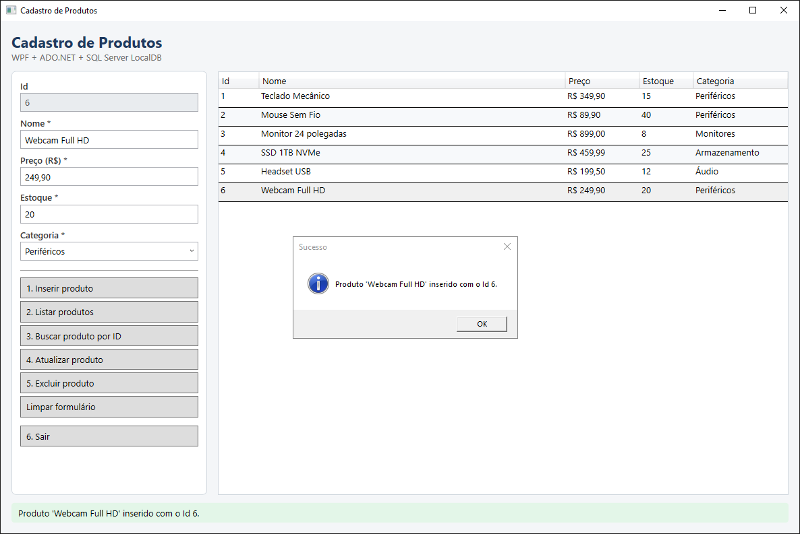
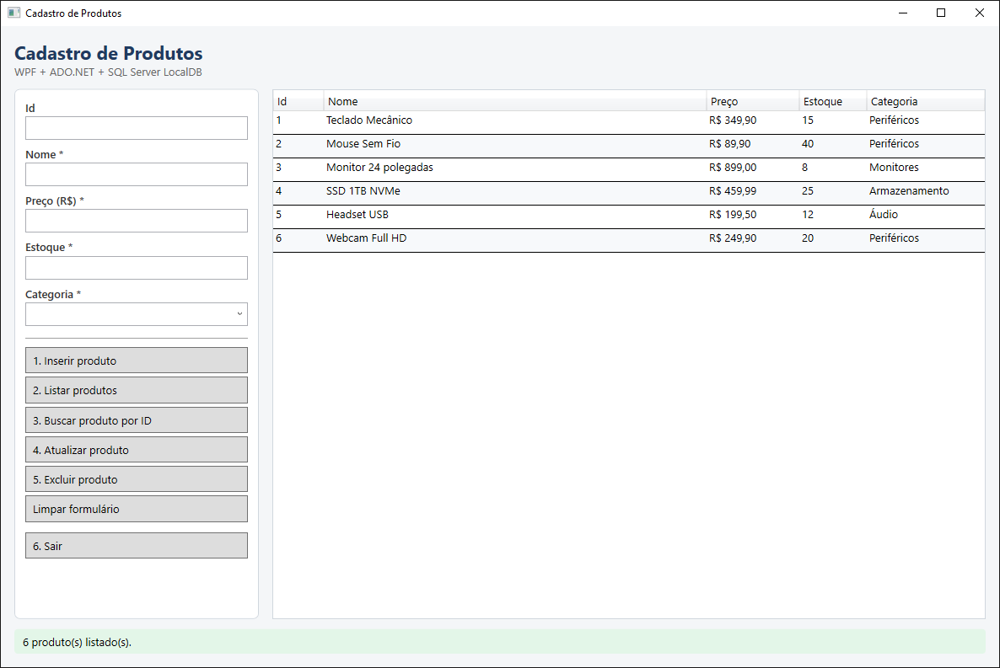
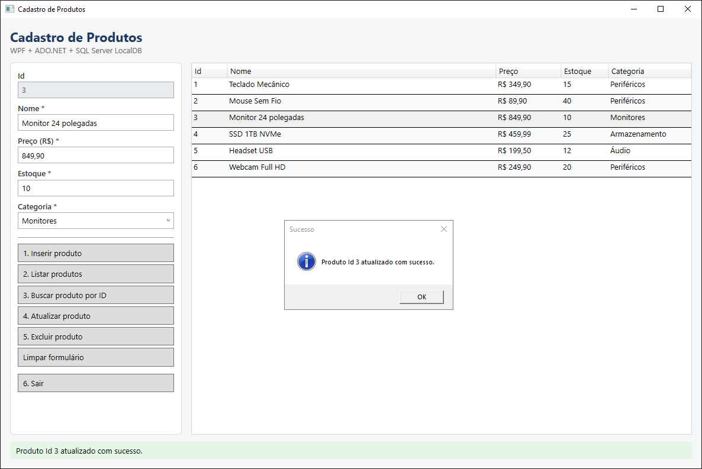
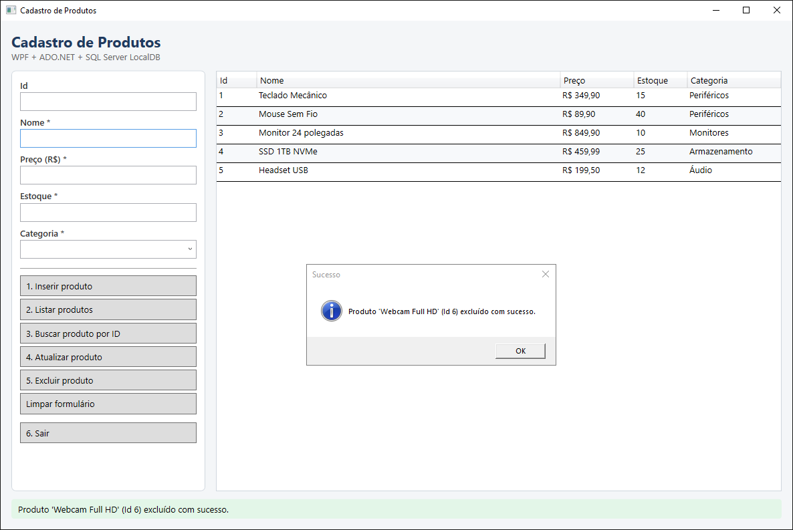

# ProdutosApp — Cadastro de Produtos (WPF + ADO.NET + SQL Server LocalDB)

Aplicação desktop em **C# / WPF (.NET 8)** para cadastrar e gerenciar produtos. O acesso a dados é feito com **ADO.NET puro** (`SqlConnection`, `SqlCommand`, `SqlDataReader`, `SqlTransaction`), sem Entity Framework nem Dapper, num banco **SQL Server LocalDB**.

## Tecnologias

| Tecnologia | Uso |
|---|---|
| .NET 8 / C# 12 | Plataforma e linguagem |
| WPF | Interface gráfica (janela única) |
| Microsoft.Data.SqlClient | ADO.NET para SQL Server |
| Microsoft.Extensions.Configuration.Json | Leitura da connection string do `appsettings.json` |
| SQL Server LocalDB | Banco de dados local |
| xUnit | Testes unitários e de integração |

## Funcionalidades

1. Inserir produto
2. Listar produtos (somente os ativos)
3. Buscar produto por ID
4. Atualizar produto
5. Excluir produto (exclusão lógica, com confirmação)
6. Sair

Além disso: botão **Limpar**, validação dos campos antes de acessar o banco, mensagens de sucesso e erro (MessageBox + barra de status) e log de todas as operações em arquivo.

## Pré-requisitos

- **Visual Studio 2022** (carga de trabalho "Desenvolvimento para desktop com .NET") **ou** o **.NET 8 SDK**
- **SQL Server LocalDB** (já vem com o Visual Studio; também pode ser instalado pelo instalador do SQL Server Express)
- Opcional: **SSMS** ou o utilitário **sqlcmd** para executar o script do banco

Para conferir se o LocalDB está instalado:

```bash
sqllocaldb info
```

## Como executar

### 1. Clonar o repositório

```bash
git clone <url-do-repositorio>
cd ProdutosApp
```

### 2. Criar o banco de dados

Execute o script `database/script.sql` (ele pode ser executado mais de uma vez sem erro):

```bash
sqlcmd -S "(localdb)\MSSQLLocalDB" -i database/script.sql
```

Ou abra o arquivo no **SSMS**, conecte em `(localdb)\MSSQLLocalDB` e clique em **Executar**.

O script cria o banco `ProdutosDB`, a tabela `Produtos` e insere 5 produtos de exemplo.

### 3. Conferir o `appsettings.json`

Arquivo `ProdutosApp/appsettings.json`:

```json
{
  "ConnectionStrings": {
    "DefaultConnection": "Server=(localdb)\\MSSQLLocalDB;Database=ProdutosDB;Trusted_Connection=True;TrustServerCertificate=True;"
  }
}
```

Se a sua instância do LocalDB tiver outro nome, altere o valor de `Server`. O arquivo é copiado automaticamente para a pasta de saída (`CopyToOutputDirectory = PreserveNewest`).

### 4. Rodar a aplicação

- **Visual Studio:** abra `ProdutosApp.sln`, defina `ProdutosApp` como projeto de inicialização e pressione **F5**.
- **Linha de comando:**

```bash
dotnet run --project ProdutosApp
```

### 5. Rodar os testes

```bash
dotnet test
```

Os testes de integração usam o mesmo LocalDB e executam o `script.sql` automaticamente antes de começar. Todos os registros criados pelos testes são apagados ao final de cada teste.

## Estrutura de pastas

```
ProdutosApp/                         (raiz do repositório)
├── ProdutosApp.sln                  solução com os dois projetos
├── ProdutosApp/                     aplicação WPF
│   ├── Models/Produto.cs            entidade Produto (espelho da tabela)
│   ├── Data/IProdutoRepository.cs   contrato de acesso a dados usado pela tela
│   ├── Data/ProdutoRepository.cs    implementação com ADO.NET (todo o SQL fica aqui)
│   ├── Data/DatabaseConfig.cs       lê a connection string do appsettings.json
│   ├── Services/Logger.cs           log em arquivo (logs/operacoes.log)
│   ├── Services/ProdutoValidator.cs validação dos dados do formulário
│   ├── Exceptions/RepositoryException.cs  exceção com mensagem amigável
│   ├── MainWindow.xaml(.cs)         tela única (formulário, botões e DataGrid)
│   ├── App.xaml(.cs)                inicialização, cultura pt-BR e tratamento global de erros
│   └── appsettings.json             connection string
├── ProdutosApp.Tests/               projeto xUnit
│   ├── ProdutoValidatorTests.cs     testes de validação (sem banco)
│   ├── ProdutoRepositoryTests.cs    testes de integração com o LocalDB
│   └── DatabaseFixture.cs           prepara o banco e limpa os dados de teste
├── database/script.sql              criação do banco, tabela e dados de exemplo
├── prints/                          capturas de tela da aplicação
├── README.md
└── .gitignore
```

**Separação de camadas:** a `MainWindow` não tem nenhum SQL e não usa `SqlConnection`/`SqlCommand`. Ela recebe um `IProdutoRepository` (criado em `App.xaml.cs`) e só chama seus métodos. Todo o SQL fica em `ProdutoRepository`.

## Decisões técnicas

### Prevenção de SQL Injection

Todos os comandos usam **parâmetros** (`SqlParameter`) com tipo explícito. Nenhum valor digitado pelo usuário é concatenado ou interpolado no texto SQL:

```csharp
const string sql = "SELECT Id, Nome, Preco, Estoque, Categoria, Ativo FROM dbo.Produtos WHERE Id = @Id AND Ativo = 1;";
comando.Parameters.Add("@Id", SqlDbType.Int).Value = id;
```

O SQL Server recebe o comando e os valores **separadamente**, então um texto como `'; DROP TABLE Produtos; --` é tratado apenas como um dado e é gravado literalmente na coluna `Nome`. O teste `Inserir_TentativaDeSqlInjectionNoNome_EhGravadaComoTextoComum` comprova isso: o nome é gravado exatamente como foi digitado e a tabela continua existindo.

### Id gerado no INSERT

O `INSERT` e o `SET @NovoId = CAST(SCOPE_IDENTITY() AS INT)` são enviados **no mesmo comando**, e o Id volta por um parâmetro de saída (`ParameterDirection.Output`). Assim o INSERT é executado com `ExecuteNonQuery`. Um `SELECT SCOPE_IDENTITY()` em um comando separado retornaria `NULL`, porque cada comando parametrizado roda em seu próprio escopo (via `sp_executesql`).

### Tratamento de erros

- O repositório captura `SqlException` e relança uma **`RepositoryException`** com uma mensagem amigável, mantendo a exceção original em `InnerException`.
- A mensagem é escolhida pelo **número do erro** do SQL Server:

| Erro | Situação | Mensagem |
|---|---|---|
| 2627 / 2601 | chave duplicada | registro duplicado |
| 547 | violação de CHECK/FK | preço e estoque não podem ser negativos |
| 2628 / 8152 | texto maior que a coluna | limite de caracteres |
| 4060 / 208 | banco ou tabela inexistente | executar o script.sql |
| -2 | tempo esgotado | tentar novamente |
| falha ao abrir a conexão | LocalDB parado, instância errada etc. | verificar LocalDB e connection string |

- A interface captura `RepositoryException` e mostra a mensagem amigável. Qualquer outra exceção mostra uma mensagem genérica e é registrada no log. Em `App.xaml.cs` há ainda um tratamento global (`DispatcherUnhandledException`) como última proteção.
- Antes de chamar o repositório, a tela valida os dados com o `ProdutoValidator`: campos obrigatórios, preço decimal ≥ 0 (aceita vírgula, padrão pt-BR, até 2 casas), estoque inteiro ≥ 0 e Id inteiro > 0.

### Log

A classe `Logger` grava em `logs/operacoes.log`, na pasta do executável (ex.: `ProdutosApp/bin/Debug/net8.0-windows/logs/operacoes.log`). A pasta é criada se não existir. Exemplo:

```
[2026-09-29 20:08:42] [INFO] INICIAR - Aplicação iniciada
[2026-09-29 20:08:43] [INFO] LISTAR - 5 produto(s) ativo(s) listado(s)
[2026-09-29 20:09:10] [INFO] INSERIR - Produto Id 6 'Webcam Full HD' inserido
[2026-09-29 20:09:31] [ERRO] LISTAR - Falha ao abrir a conexão com o banco (erro SQL -1983577849) | SqlException: ...
```

O `Logger` é **thread-safe** (`lock`) e nunca derruba a aplicação: se não conseguir gravar, o erro é ignorado (apenas escrito na saída de depuração).

### Transação e soft delete

A exclusão é **lógica** (*soft delete*): o registro não é apagado, apenas recebe `Ativo = 0`. Os métodos `Listar`, `BuscarPorId` e `Atualizar` consideram somente registros com `Ativo = 1`, então o produto "some" da aplicação mas continua no banco para histórico e auditoria.

O `UPDATE ... SET Ativo = 0` é executado dentro de uma **`SqlTransaction`**:

- se exatamente 1 linha foi afetada → `Commit`;
- se nenhuma linha foi afetada (Id inexistente ou já excluído) → `Rollback` e retorna `false`;
- se ocorrer erro → `Rollback` e a exceção é tratada.

## Prints

As imagens ficam na pasta [`prints/`](prints/).

| Operação | Imagem |
|---|---|
| Inserir produto |  |
| Listar produtos |  |
| Atualizar produto |  |
| Excluir produto |  |
